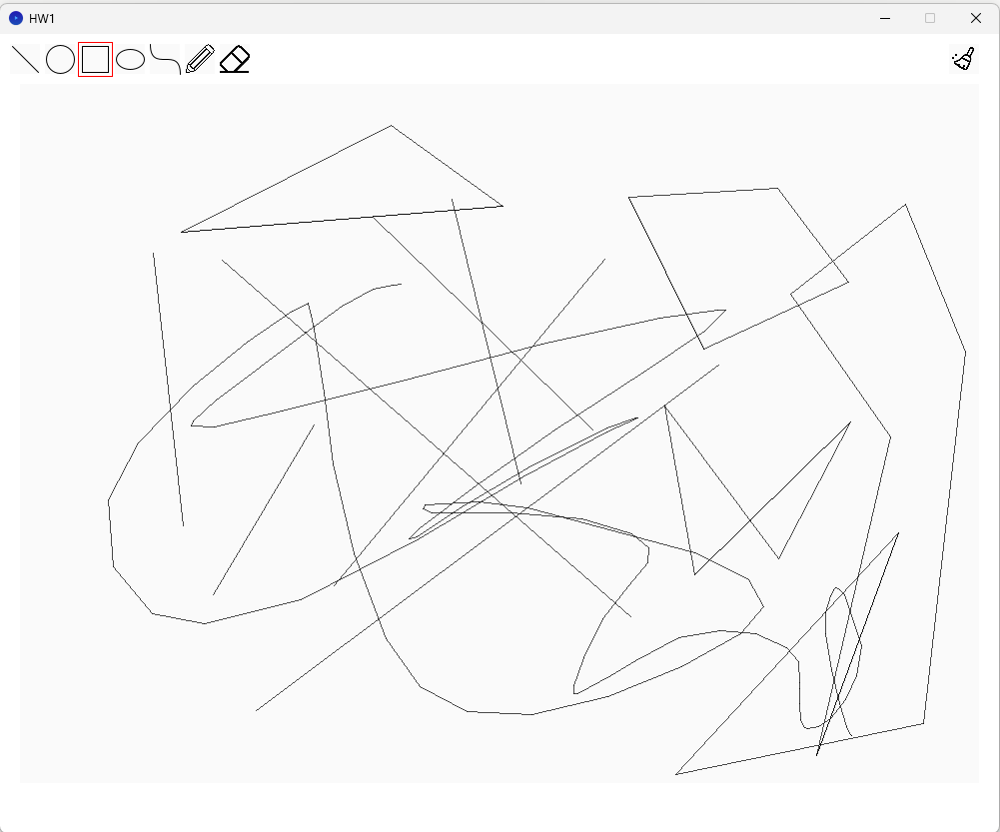
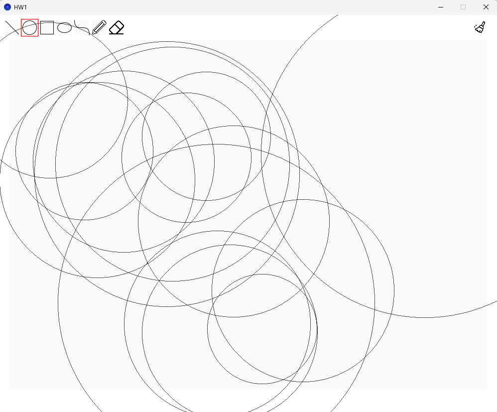
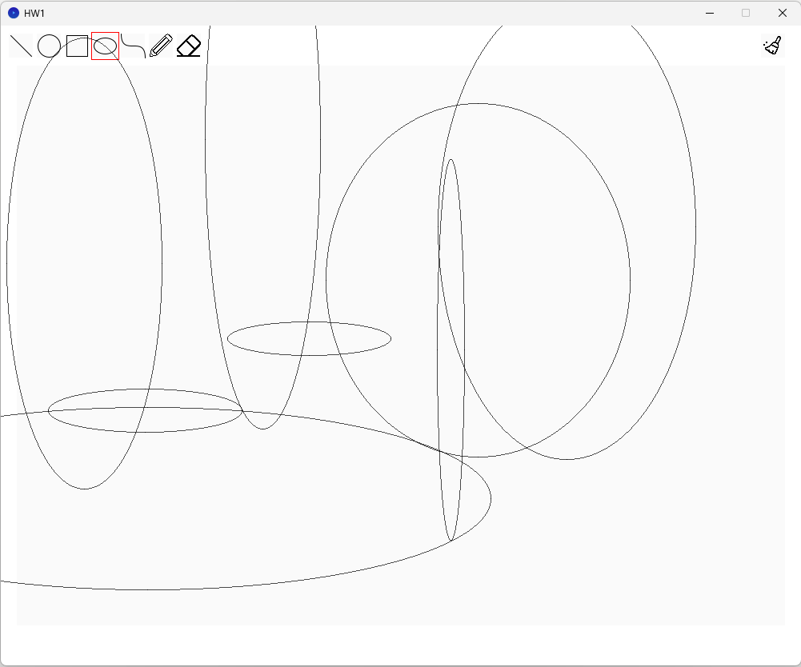
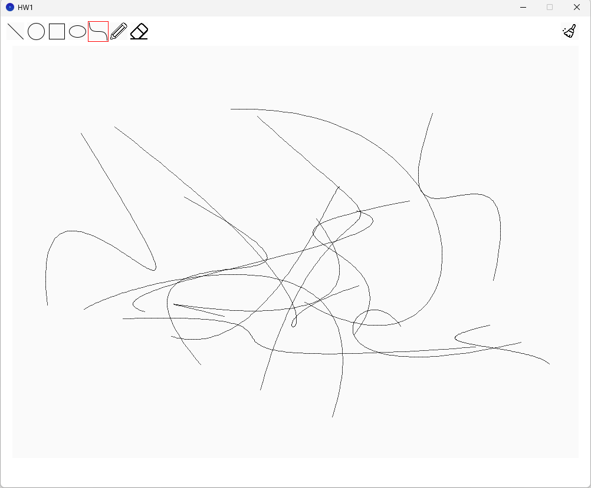
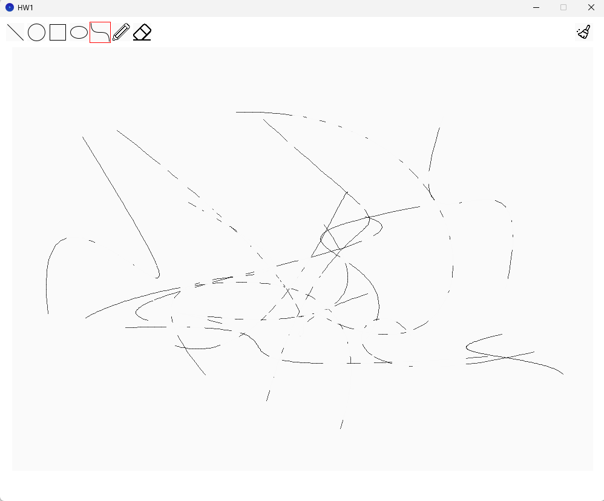

# Computer Graphics - Lab 1

## 完成的任務與成果截圖

在本次作業中，我完成了 `HW1/util.pde` 中所有基礎繪圖與擦除功能：

### 1. 畫線演算法 (`CGLine`)
- **實作方式**：採用布雷森漢姆直線演算法（Bresenham's line algorithm），根據斜率是否大於 1 決定主軸，並以整數誤差項決定座標遞增，完成畫線、多邊形與鉛筆功能。
- **成果截圖**：
  

### 2. 畫圓演算法 (`CGCircle`)
- **實作方式**：採用布雷森漢姆畫圓演算法（Bresenham's circle algorithm），計算八分之一圓並利用八分對稱性畫出完整圓形。
- **成果截圖**：
  

### 3. 畫橢圓演算法 (`CGEllipse`)
- **實作方式**：採用中點畫橢圓演算法（Midpoint ellipse drawing algorithm），在第一象限以切線斜率 `-1` 為界分為兩個區域計算，再以四分對稱畫出橢圓。
- **成果截圖**：
  

### 4. 貝茲曲線演算法 (`CGCurve`)
- **實作方式**：採用德卡斯特里奧演算法（De Casteljau's algorithm），將 $t \in [0, 1]$ 切分為 100 個步長取樣，並呼叫 `CGLine` 連接相鄰取樣點以繪製平滑曲線。
- **成果截圖**：
  

### 5. 橡皮擦 (`CGEraser`)
- **實作方式**：以雙重迴圈（步長 `0.5f`）走訪 `p1` 到 `p2` 的矩形區域，呼叫 `drawPoint(x, y, color(250))` 塗上背景色以擦除筆畫。
- **成果截圖**：
  

---

## AI 工具協助說明

在本次作業中，我使用 AI（Gemini）協助以下事項：
1. 說明模板程式碼架構、Processing 基本語法與 VS Code 環境設定。
2. 提供畫圓演算法的偽代碼參考，以及協助修正 `deCasteljau` 函式中陣列指標覆寫的問題（改用 `.clone()`）。
3. 排查橡皮擦單次擦除時呈現半透明的問題，透過縮小走訪步長解決。
4. 協助撰寫與排版這份 `README.md`。

---

## 參考網站

- **直線**：[布雷森漢姆直線演算法 - 維基百科，自由的百科全書](https://zh.wikipedia.org/wiki/%E5%B8%83%E9%9B%B7%E6%A3%AE%E6%BC%A2%E5%A7%86%E7%9B%B4%E7%B7%9A%E6%BC%94%E7%AE%97%E6%B3%95)
- **圓**：[Bresenham’s circle drawing algorithm - GeeksforGeeks](https://www.geeksforgeeks.org/c/bresenhams-circle-drawing-algorithm/)
- **橢圓**：[Midpoint ellipse drawing algorithm - GeeksforGeeks](https://www.geeksforgeeks.org/dsa/midpoint-ellipse-drawing-algorithm/)
- **曲線**：[Bezier curve](https://javascript.info/bezier-curve#de-casteljau-s-algorithm)、[De Casteljau's algorithm - Wikipedia](https://en.wikipedia.org/wiki/De_Casteljau%27s_algorithm)
